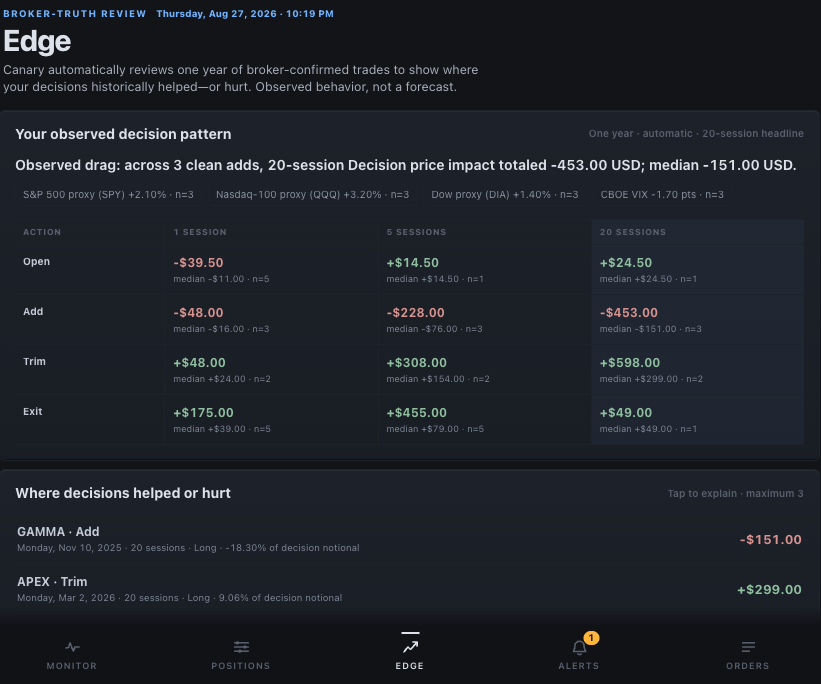

# Canary

[](https://github.com/osauer/canary/actions/workflows/ci.yml)
[](https://github.com/osauer/canary/releases/latest)
[](LICENSE)

繁體中文：[網站及入門指南](https://osauer.dev/canary/zh-hant/) · 简体中文：[网站及入门指南](https://osauer.dev/canary/zh-hans/)

**A risk desk for your Interactive Brokers account. It reads your account for
you and your AI agent, checks it against your limits, and, in the trading build,
places the trades you authorise.**

Canary runs beside your IB Gateway or TWS and nothing runs on a server of mine.
It tells you what needs attention today. It runs twenty discipline checks
against limits you set and names the ones your positions breach. It shows
exposure by underlying. Canary Edge shows what the price did 1, 5 and 20
sessions after your past stock and ETF trades, from your broker statements,
where a decision repeated often enough to count. The same readings come as
text, as JSON, in a paired phone app, and as MCP tools for Claude Desktop,
Claude Code, Cursor or Zed.

It comes in two builds. The standard binary reads; it has no compiled order
path. The trading binary, a separate download, also executes orders, and only
the ones you authorised: a transaction you confirmed, or a close or reduction
the daemon runs under a bucket you listed in your written policy, a list that
ships empty. Every order is pinned to one account, client ID and mode, consumes
a preview token for that exact draft, is journaled with its origin before it is
sent, and passes the risk policy's order limits, the mandate gate and the
freeze. An agent trades only through the gated CLI. The MCP server has no order
or preview tool in any build. Canary never decides a trade on its own.

**[Documentation](https://osauer.dev/canary/docs/)** · [Install](docs/docs/start/install.md) · [First session](docs/docs/start/first-session.md) · [Canary Edge](docs/docs/understand/edge.md) · [MCP tools](docs/docs/reference/mcp-tools.md) · [Safety](SECURITY.md) · [Privacy](PRIVACY.md)

## Start

You need IB Gateway 10.37+ or TWS with API socket access enabled, an IBKR Pro
account, and macOS or Linux on arm64 or amd64. Paper and live both work. There
is no Windows build; use WSL.

**Terminal, and every MCP host.** One signed binary in `~/.local/bin`:

```sh
curl -fsSL https://raw.githubusercontent.com/osauer/canary/main/install.sh | sh
canary status    # show which Gateway and account Canary reached
canary brief     # review what changed and what needs attention
```

The [install guide](docs/docs/start/install.md) shows how to inspect the script
first and covers every other installation path.

**Claude Desktop.** Download the MCP Bundle,
[`canary.mcpb`](https://github.com/osauer/canary/releases/latest/download/canary.mcpb),
open it with Claude Desktop, then quit and relaunch Claude. The
[walkthrough](https://osauer.dev/canary/claude-desktop-interactive-brokers/)
covers the first connection.

**Any other MCP host.** Install the binary as above, then point the host at its
absolute path; `which canary` prints it.

```json
{
  "mcpServers": {
    "canary": {
      "command": "/ABSOLUTE/PATH/TO/canary",
      "args": ["mcp"]
    }
  }
}
```

A first question that works in any host:

> What needs attention today, and which data is missing or stale?



_Canary Edge in the paired app, rendered from synthetic data: what the price did
after past decisions, and how much evidence supports each row._

## Ways in

| You want to… | Start with | What you get |
| --- | --- | --- |
| Ask an agent about the account | The MCP Bundle, or `canary mcp` from any local framework that can launch a stdio MCP server | Read-only tools; the MCP server has no order or preview tool |
| Work in a terminal or script | `canary brief`, `canary positions --by underlying`, and `--json` | Every reading as text or JSON, from the same source as the app and the MCP tools |
| Check the desk from a phone | `canary app`, then `canary app pair` | A paired web app on your phone; local by default, remote access optional |
| Read Canary from your own Go program | `github.com/osauer/canary/v2`, the daemon client | The daemon's read methods over its local socket; its one submit method is served by a trading daemon only |
| Build directly on the TWS protocol | `github.com/osauer/canary/v2/pkg/ibkr` | A low-level transport; it carries no policy, authorisation or journal, those stay in your program |

## MCP hosts

Ask plain questions rather than naming tools. The
[host guide](docs/docs/start/hosts.md) covers Claude Code, Cursor, Zed,
continuously running agents, logs, and connection checks. The generated
[MCP reference](docs/docs/reference/mcp-tools.md) lists every tool and its
schema.

## Terminal and paired app

Every data command supports `--json`:

```sh
canary account
canary positions --by underlying
canary edge
canary rules
canary regime --explain
canary stress --details
```

Run `canary status` first for connection problems and `canary data health` for
missing or stale data. `canary --help` and the
[CLI reference](docs/docs/reference/cli.md) list every command and flag.

For the paired app, run `canary app` on the machine that owns the Gateway or
TWS session, then run `canary app pair` and scan the QR code. The
[app guide](docs/docs/operate/app.md) covers pairing, remote access, and push
notifications.

## Experimental: Futu OpenD

Canary can also read a Futu or moomoo account through OpenD, Futu's local
gateway, while OpenD is running and logged in. This support is experimental.
Reading holdings has been tested only against a stand-in for OpenD written for
Canary's tests, so check what it shows against your broker. Canary cannot place,
change or cancel orders through OpenD: it refuses the request and sends nothing
to your broker.

```toml
[broker]
kind = "opend"
```

With one real account on your login, Canary uses it. With several, it refuses and
`canary status` lists them; set `account` under `[opend]` to the one to use. A
simulated account is never picked: to use one, set `account` to its id.

With this setting, Canary shows account balances, stock and ETF positions, and
quotes for the Hong Kong and US markets where your OpenD login has the quote
rights. Options, futures and anything else you hold there appear in a separate
list at the value OpenD reports, unconverted and not checked by Canary. Exposure
and limit checks do not count them, so those figures do not cover your whole
account. Holdings outside the account's base currency are converted at a rate
worked out from OpenD's own account totals, not a quoted rate; where that is not
possible they are not measured, and limit checks report that they cannot judge
them. Many features are not
available, among them daily P&L, the regime, portfolio stress, Edge, statement
reporting, the market overview, the market tape and technical analysis; `canary status` lists most
of them.

Each daemon serves one broker. To run OpenD beside IBKR, start a second daemon
with its own `XDG_CONFIG_HOME`, `XDG_STATE_HOME`, `XDG_CACHE_HOME`,
`XDG_RUNTIME_DIR` and `CANARY_SOCKET`. The
[configuration reference](docs/docs/reference/config.md) lists every key.

## Go wire-protocol library

[](https://osauer.dev/canary/coverage/pkg-ibkr.html)

`pkg/ibkr` is a clean-room Go library for the TWS wire protocol. It transports
broker requests only. Its API reference is on
[pkg.go.dev](https://pkg.go.dev/github.com/osauer/canary/v2/pkg/ibkr), and its
statement coverage is updated on each push to main as a
[line-by-line report](https://osauer.dev/canary/coverage/pkg-ibkr.html).

`go install github.com/osauer/canary/v2/cmd/canary@latest`
installs the v2 CLI, not the current v3 release; use the installer for the
binary. Start with the [package documentation](pkg/ibkr/doc.go) and the
[wire protocol page](docs/docs/internals/protocol.md).

## Safety and privacy

The standard binary has no compiled order path, and
the installer, updater and MCP Bundle never install the trading binary. The
trading binary executes what you authorised and nothing else. The daemon checks
every order at preview, at admission and at the final send: account, client ID
and mode pins, the preview token for that draft, the journal entry written
before the send, the risk policy's order limits, the mandate gate and the
freeze. [Gated orders](docs/docs/operate/orders.md) has the detail.

Canary has no telemetry and does not send account IDs, balances, quantities, or
P/L to the maintainer. [PRIVACY.md](PRIVACY.md) is the data map.
[SECURITY.md](SECURITY.md) covers the threat model and signed releases.

## Documentation and legal

- [Daily desk workflow](docs/docs/operate/daily-desk.md)
- [Troubleshooting](docs/docs/start/troubleshooting.md)
- [Configuration](docs/docs/reference/config.md)
- [Release and update policy](docs/docs/reference/releases.md)
- [Contributing](CONTRIBUTING.md)

Canary is an independent third-party client for Interactive Brokers' publicly
documented TWS API. It is not built, endorsed, sponsored, or supported by
Interactive Brokers Group, Inc. or its affiliates. `pkg/ibkr` redistributes no
Interactive Brokers code, libraries, jars, or market data. Canary's OpenD client
is likewise independent and is not built, endorsed, sponsored, or supported by
Futu or its affiliates; `pkg/futu` includes protocol definitions from Futu's
public client under the Apache License 2.0, as
[its notice](pkg/futu/internal/pb/proto/NOTICE) sets out. Nothing here is
investment advice.

Canary is a private project of Oliver Sauer.

MIT. See [LICENSE](LICENSE).
